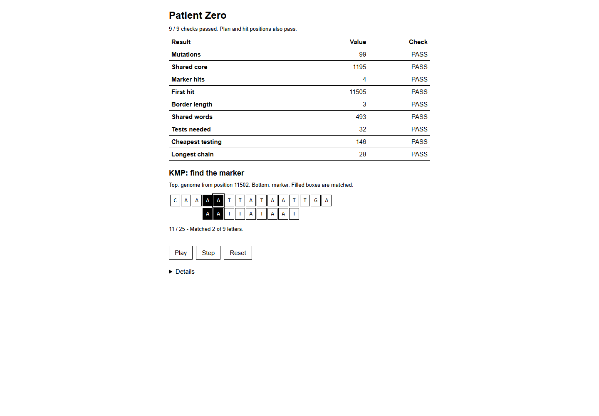

# Assignment 4. Patient Zero

Student ID: **254332**  
Name: **Koishin Bakhtiyar**  
Group: **SE-2540**

Course: Design and Analysis of Algorithms. Java 17+, standard library only.

## Run and check

Run these commands from the `patient-zero` folder:

```text
javac -encoding UTF-8 -d out src/*.java
java "-Dfile.encoding=UTF-8" -cp out Main
java -cp out Bench
```

The quoted UTF-8 option preserves UTF-8 text in the HTML on Windows with
Java 17. The supplied `Render.java` is unchanged. Without JVM options,
`java -cp out Main` computes the same nine answers.

The personal data are already included. To regenerate the exact same files:

```text
java tools/MakeVariant.java 254332 data
```

Checks:

```text
java tools/Check.java
java -cp out tools/AlgorithmCheck.java
java "-Dfile.encoding=UTF-8" -cp out Main
```

`Check.java` compiles the source automatically. Its three example runs overwrite
`output/outbreak.html`, so run `Main` afterwards to restore the personal report.
Open `output/outbreak.html` in a browser; the existing PNG is the full-page
screenshot for ID 254332. If the source or data change, regenerate the screenshot.

## Program output

Data generated with the original `tools/MakeVariant.java` and ID `254332`:
strain A has 1,258 letters, strain B has 1,256, the genome has 26,096, and the tree
has 78 people.

```text
Mutations: 99
Shared core: 1195
Marker hits: 4
First hit: 11505
Border length: 3
Shared words: 493
Tests needed: 32
Cheapest testing: 146
Longest chain: 28
```

The initial algorithm-validation run took approximately **418 ms** wall-clock time, including JVM
startup and HTML generation, on the validation machine. All nine values agree
with the independent calculations in the lab console.



## Questions

### Mission 1

`d[i][j]` is the minimum number of single-letter edits needed to turn the first
`i` letters of A into the first `j` letters of B. Set `d[i][0] = i` and
`d[0][j] = j`, then take the minimum of `d[i-1][j] + 1` (deletion),
`d[i][j-1] + 1` (insertion), and `d[i-1][j-1] + cost` (replacement or match),
where `cost` is 0 for equal letters and 1 otherwise. Each option describes a
possible last edit, so the minimum covers every optimal solution.

### Mission 2

A common substring must be contiguous, whereas a common subsequence may skip
letters while keeping their order. The LCS table takes the diagonal plus one
when the current letters match, and the maximum of the top and left cells
otherwise. My shared core has length 1,195, but only 333 letters match at the
same index, because insertions and deletions shift matching stretches without
destroying their relative order.

### Mission 3

`pi[i]` is the length of the longest proper prefix of the marker prefix ending
at `i` that is also its suffix. On a mismatch KMP follows `pi[matched-1]` to
reuse an already matched border without moving the text index backwards;
after a complete match it uses the same fallback to preserve overlaps.
My marker is `AATTATAAT`, whose prefix function is `[0, 1, 0, 0, 1, 0, 1, 2, 3]`,
so its border length is 3: `AAT` occurs at both ends and is shorter than the
whole marker.

### Mission 4

A hash is only a compact fingerprint: different words can have the same hash,
so every candidate must be checked letter by letter before it is counted.
The rolling update takes constant time, but many equal hashes require many
candidate comparisons, each costing up to `k` letter checks. This implementation
stores all B positions in each hash bucket, so a collision-heavy worst case is
`O(N_A * N_B * k)`, where `N_A` and `N_B` are the numbers of windows in the two
strains; the loop stops after the first exact match for each position in A.

### Mission 5

For vertex `v`, `take[v]` is the cheapest cover of its subtree with `v` tested,
and `skip[v]` is the cheapest cover with `v` not tested. Compute
`take[v] = cost[v] + sum(min(take[child], skip[child]))` and
`skip[v] = sum(take[child])`, choose the cheaper state at root 0, then reconstruct
downwards, forcing a child to be tested whenever its parent is not tested.
Greedy selection by degree ignores costs: in a star with three leaves, a centre
costing 10 and leaves costing 1 each, testing the centre costs 10 while testing
all leaves covers every edge for only 3.

## AI use

**OpenAI Codex (ChatGPT)** was used to implement the five algorithmic missions,
write an independent regression checker, draft the README explanations, run
compilation and tests, record benchmark results, and capture the report screenshot.
The local Git commits were created by Codex and are attributed to Codex rather
than presented as unaided student work.

The source material was the supplied course starter archive, including
`docs/Assignment4.pdf`, `START_HERE.md`, `docs/Hints.md`, and
`docs/Assignment4_defense_prep.pdf`. No external website or book code was copied.
The provided runner, input parser, renderer, generator, benchmark, examples,
and original tools have been preserved. At the user's request, `src/lab.html`
was simplified into a short black-and-white page using basic HTML, CSS and
JavaScript. It shows nine results and a real KMP animation on a short excerpt
from the personal genome, with Play/Pause, Step and Reset controls. Checks,
marker details and the testing plan remain available under Details. The generated
HTML and screenshot use this compact template; no external libraries are needed.

The student must review and understand the implementation and adapt the written
explanations into their own words before submission. The assignment's AI rules
require disclosure and do not permit submitting unchanged AI-generated work;
this note does not replace that requirement. The separate Moodle defense is not
part of this prepared project.

## Timing (Mission 7)

Actual output of the unmodified `java -cp out Bench`, measured on Windows with
Microsoft OpenJDK **17.0.20.1**, 9 November 2026. Every entry is the average of the
three runs performed by the supplied benchmark. Decimal commas from the console
are written as decimal points below.

| test | size | time (ms) |
|---|---|---|
| naive search | 20,000 / 40,000 / 80,000 | 62.7 / 120.4 / 252.7 |
| KMP | 20,000 / 40,000 / 80,000 | 3.3 / 1.7 / 1.4 |
| edit distance | 500 / 1,000 / 2,000 / 4,000 | 7.6 / 4.8 / 22.4 / 84.6 |

With the pattern fixed at 2,000 letters, doubling the text made naive search
about 1.92x and 2.10x slower, consistent with its `O(n*m)` worst case being
linear in `n` when `m` is fixed. KMP is theoretically `O(n+m)`, but these very
short measurements decrease (0.52x and 0.82x) as the JVM warms up, so this run
cannot demonstrate its asymptotic scaling from the ratios alone. Doubling both
edit-distance input lengths should multiply the work by about four; the measured
ratios are 0.63x, 4.67x and 3.78x, with the first affected by warm-up and the
larger inputs closer to the quadratic prediction.

## Complexity

Let `n = |A|` and `m = |B|` for strain comparisons. For KMP, `n` is text length,
`m` is pattern length and `h` is the number of reported hits. For shared words,
`N_A = max(0, n-k+1)`, `N_B = max(0, m-k+1)` and `C` is the number of candidate
window comparisons. Let `v` be the number of tree vertices.

| algorithm | time | extra space | assumptions |
|---|---|---|---|
| Edit distance | `O((n+1)(m+1))`, normally `O(nm)` | `O((n+1)(m+1))` | Full prefix table; insertion, deletion and replacement each cost 1. |
| LCS | `O((n+1)(m+1))`, normally `O(nm)` | `O((n+1)(m+1))` | Full table; subsequences preserve order and may have gaps. |
| Prefix function | `O(m)` | `O(m)` | Each fallback reduces the matched prefix length; no rescanning of text. |
| KMP, including prefix function | `O(n+m)` | `O(m+h)` | Includes stored output positions; an empty pattern returns all `n+1` boundaries. |
| Rabin-Karp (shared words) | Expected `O(n+m+k+C*k)`; collision-heavy worst case `O(n+m+k+N_A*N_B*k)` | `O(N_B)` | Expected constant-time HashMap operations; all B positions retained; exact verification; fixed `k=12` and few collisions give near-linear scans. |
| Tree cover DP and reconstruction | `O(v)` | `O(v)` | Valid undirected tree, rooted at 0; includes state arrays, output and recursion stack. Uses `long` totals. |
| Longest chain | `O(v)` | `O(v)` worst case | One DFS; keep the two longest downward branches; count edges, not vertices. |

Recursive tree traversal is appropriate for the assignment's roughly 60-100
vertices. `sharedWords` rejects `k <= 0` and returns zero when a strain is shorter
than `k`. These boundary conventions do not change the assignment's valid data.

## Validation

- Java 17 compilation with `-Xlint:all`: passed without warnings.
- Original `java tools/Check.java`: all 9 lines correct on each of `tiny`,
  `small`, and `dense` (27 values total).
- `java -cp out tools/AlgorithmCheck.java`: 16,789 assertions passed using
  independent exhaustive/naive oracles, including real hash collisions,
  overlapping hits, zero-cost tree covers, reconstruction, and costs above the
  signed 32-bit range.
- Simplified personal report in Chrome: 9 textual PASS checks, matching marker
  positions and a valid minimum-cost plan; no JavaScript page errors.
- Desktop and 390/320 px responsive browser layouts inspected: black and white,
  with no horizontal page overflow.
- KMP animation: Play/Pause, Step, Reset, completion and matched positions
  checked in the browser. Nothing starts automatically.
- Full-page `output/outbreak.png` captured during a KMP step and visually inspected.

## Before submission

The four personal data files, all source code, the README, the HTML and PNG
report, and a local `main` Git history with a separate commit for each coding
mission are included. Generated `.class` files are deliberately excluded.

Student review and revision of the AI-assisted material are still required.
After that, publish this local repository to a **public GitHub repository** and
submit its link in **Moodle** before the deadline. Neither publication nor Moodle
submission has been performed. Keep the included `.git` directory when extracting
the ZIP so the actual local commit history is retained; do not upload only loose
files if the commit history is needed. Original setup and publishing guidance is
in `START_HERE.md`.
